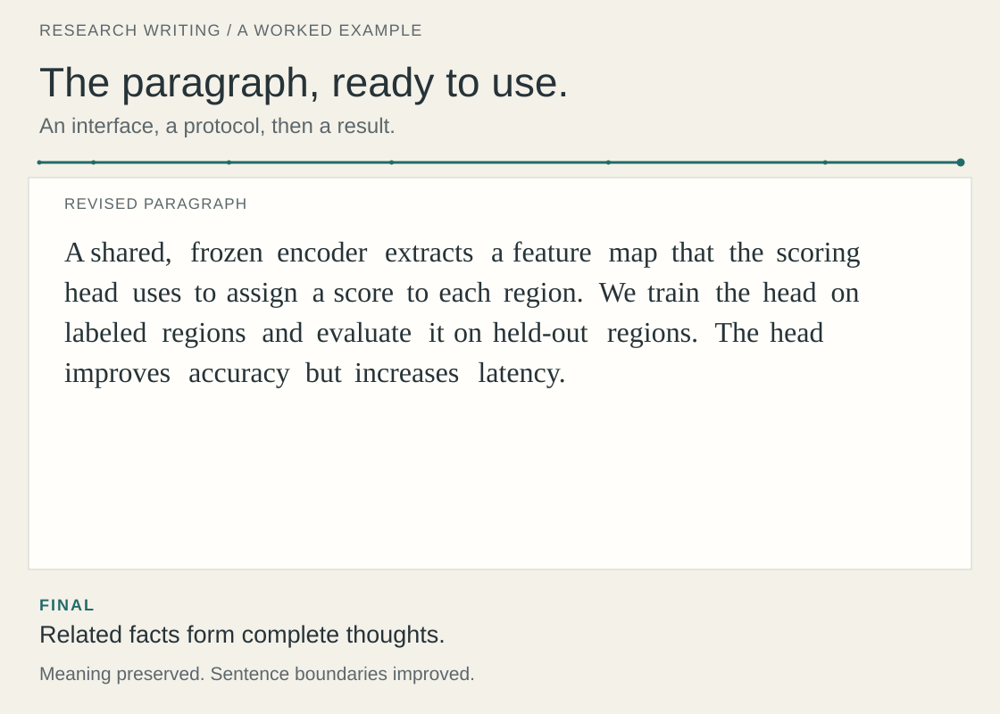

# Research Writing Skill

A skill for revising English research papers: clearer sentences, easier comparisons, and a better path through the argument.

[Quick start](#quick-start) · [Examples](#before-and-after) · [Sources](#sources) · [中文](README.zh-CN.md)

<picture>
  <source media="(prefers-reduced-motion: no-preference) and (max-width: 600px)" type="image/gif" srcset="assets/workflow/mobile.gif">
  <source media="(prefers-reduced-motion: no-preference)" type="image/gif" srcset="assets/workflow/desktop.gif">
  <source media="(max-width: 600px)" type="image/svg+xml" srcset="assets/workflow/mobile-still.svg">
  
</picture>

Watch a sentence-level edit unfold. Stock phrasing goes; repeated “We,” precise technical terms, and a real contrast stay where they help. [Read the full example](examples/workflow.md) · [Static view](assets/workflow/desktop-still.svg)

Give it a paragraph and say what you want to improve. It returns a revision with brief reasons for the edits, preserving the technical meaning, numbers, and conditions. For a larger revision, ask it to work on an abstract, section, or argument.

The skill offers sentence cards for everyday editing and a guide to choosing the right scope for larger revisions. Detailed reference notes are mainly in Chinese; the examples and revised prose are in English.

## What it helps with

- **Sentences:** make the actor and action clear, resolve vague pronouns, and connect one sentence to the next.
- **Comparisons:** make differences in methods, settings, or results easy to follow.
- **Paragraphs and sections:** arrange the question, evidence, and conclusion in a useful order.
- **Final wording:** remove filler, choose precise verbs, and keep terminology consistent.

For a routine polish, it works on sentences and wording. You can ask for broader changes when the structure also needs attention.

## Quick start

### Install in Codex

Download or clone this repository. Copy `skills/revise-research-writing` into `~/.agents/skills/` for personal use, or into your project's `.agents/skills/` folder for that project.

Run the following from the repository root. An existing installation is left in place so you can review local changes before updating.

<details>
<summary>macOS / Linux</summary>

```sh
target="$HOME/.agents/skills/revise-research-writing"
mkdir -p "$HOME/.agents/skills"
if [ -e "$target" ]; then
  printf '%s\n' "Already installed: $target"
else
  cp -R skills/revise-research-writing "$target"
fi
```

</details>

<details>
<summary>Windows PowerShell</summary>

```powershell
$skillRoot = Join-Path $HOME '.agents/skills'
$target = Join-Path $skillRoot 'revise-research-writing'
if (Test-Path -LiteralPath $target) {
  Write-Output "Already installed: $target"
} else {
  New-Item -ItemType Directory -Force -Path $skillRoot | Out-Null
  Copy-Item -LiteralPath 'skills/revise-research-writing' -Destination $target -Recurse
}
```

</details>

If the skill does not appear, restart the client. See the [official skill documentation](https://learn.chatgpt.com/docs/build-skills) for discovery and installation details.

### Try it on a paragraph

```text
Use $revise-research-writing to polish the paragraph below.
Keep the sentence order, technical claims, and numbers.
Return the revision and briefly explain the important edits.

[Paste your paragraph here.]
```

For an abstract that needs more structural work:

```text
Use $revise-research-writing to improve this abstract.
Help the reader follow the problem, approach, and main result.
You may reorder sentences; keep all claims tied to the results I provide.

[Paste your abstract here.]
```

### Use with another assistant

Provide [SKILL.md](skills/revise-research-writing/SKILL.md) and its `references/` folder, then ask the assistant to follow the skill and consult the relevant references. Make both available as files so the links can be followed.

This package consists of instructions and examples. It needs no additional API key, model download, or runtime dependency; the optional validator uses Python's standard library.

<a id="before--after"></a>

## Before and after

These original teaching examples use hypothetical methods and results.

### Put the action in the verb

**Before**
> The encoder performs the extraction of a feature map. For the scoring head, this map is the input used to assign one score to each region.

**After**
> The encoder extracts a feature map. The scoring head uses this map to assign one score to each region.

“Extracts” and “uses” make the two actions easy to follow. The feature map connects the sentences. [S1 and S2](skills/revise-research-writing/references/sentence-craft.md#s1)

### Make a comparison easier to read

**Before**
> Adding text improves image accuracy, whereas for text accuracy, the addition of images produces no change.

**After**
> Adding text improves image accuracy, whereas adding images leaves text accuracy unchanged.

Matching the clause structure brings out the finding: one direction improves; the other stays unchanged. [S4](skills/revise-research-writing/references/sentence-craft.md#s4)

### Keep a sentence that already works

> The encoder is frozen during adaptation. Only the region head is updated.

The stage and parameter states are clear. Both sentences can stay as they are.

[Read all seven worked examples →](examples/before-after.md)

## Inside the skill

The nine sentence cards each address a common editing problem. The assistant starts with the one to three cards relevant to your passage.

| Card | What to look for |
|---|---|
| [S1 · Subjects and verbs](skills/revise-research-writing/references/sentence-craft.md#s1) | An action buried in a noun phrase |
| [S2 · Connections between sentences](skills/revise-research-writing/references/sentence-craft.md#s2) | A sentence that does not build on the previous one |
| [S3 · Name the relationship](skills/revise-research-writing/references/sentence-craft.md#s3) | A division, comparison, or arrangement repeated in full or referred to vaguely |
| [S4 · Parallel comparisons](skills/revise-research-writing/references/sentence-craft.md#s4) | Corresponding roles or settings that are hard to compare |
| [S5 · Stages and qualifiers](skills/revise-research-writing/references/sentence-craft.md#s5) | An unclear training stage, inference condition, or “only” |
| [S6 · Opening clauses](skills/revise-research-writing/references/sentence-craft.md#s6) | Too much setup before the main point |
| [S7 · Complete conditions](skills/revise-research-writing/references/sentence-craft.md#s7) | A claim separated from its condition |
| [S8 · Benefits and limits](skills/revise-research-writing/references/sentence-craft.md#s8) | A contrast that obscures a benefit or its limit |
| [S9 · Sentence rhythm](skills/revise-research-writing/references/sentence-craft.md#s9) | Choppy sentences or unrelated points crowded together |

For larger revisions, the [eight-layer toolkit](skills/revise-research-writing/references/eight-layer-toolkit.md) covers the scientific story, argument, paper structure, sections, paragraphs, sentences, wording, and grammar. Choose the level that fits your request.

<a id="where-the-patterns-come-from"></a>

## Sources

The source notes study papers with Kaiming He or Saining Xie as last-listed authors, using a snapshot dated **2026-10-12**. These are collaborative papers. The observations describe techniques in the selected versions; author position identifies the groups, not who wrote a particular sentence. This is an independent project, unaffiliated with the authors or publishers.

- [Source guide and bibliography](skills/revise-research-writing/references/sources-and-patterns.md): paper-level observations and patterns across papers.
- [Corpus manifest](skills/revise-research-writing/references/corpus-manifest.json): titles, author lists, links, version notes, and source limitations, including public author manuscripts.
- [Observation index](skills/revise-research-writing/references/observation-index.json): page and section locations for each paper.
- [Dimension map](skills/revise-research-writing/references/dimension-map.md): editing layers (L1–L8), observation dimensions (D1–D15), and sentence cards (S1–S9).

These are qualitative reading notes from a selected corpus. The [external reference guide](skills/revise-research-writing/references/reference-integration.md) records separate influences from Nature's summary-paragraph guide and community writing projects.

## Contribute and check

A useful contribution starts with a passage that is difficult to read, a faithful revision, and an explanation of the editing choice. See [CONTRIBUTING.md](CONTRIBUTING.md).

```sh
python3 scripts/validate.py
```

The validator checks file structure, local links, source counts, card references, and example data. Review meaning and writing quality with the [worked examples](examples/before-after.md) and [behavioral cases](examples/acceptance-cases.json); the latter specify expected constraints rather than measured model performance.

## License

Original instructions, examples, scripts, and artwork use the [MIT License](LICENSE). Linked papers and third-party materials retain their own terms. Source credits and permissions are collected in [ATTRIBUTION.md](ATTRIBUTION.md); release history is in [CHANGELOG.md](CHANGELOG.md).

<a id="中文说明"></a>

[完整中文说明 →](README.zh-CN.md)
