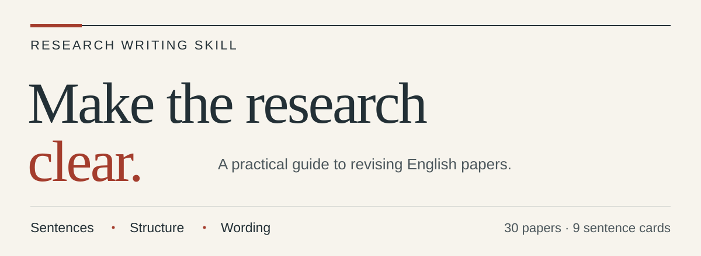
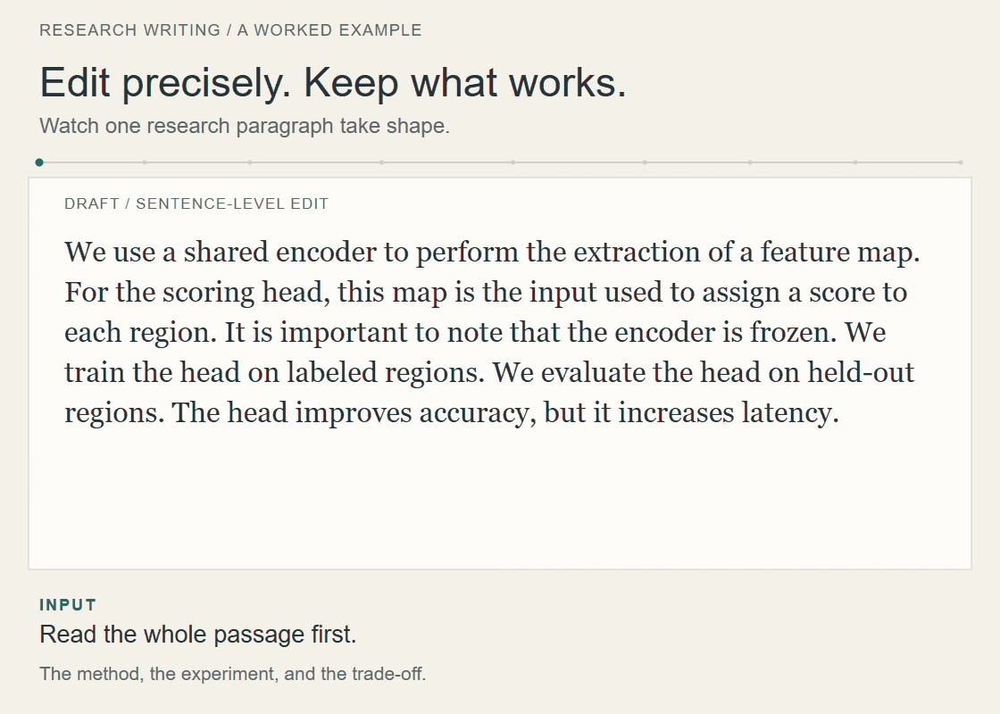

<picture>
  <source media="(max-width: 600px)" srcset="assets/banner-mobile.svg">
  
</picture>

# Research Writing Skill

一个帮助你修改英文论文的 skill：把句子写顺，把比较讲清楚，让读者更容易跟上论证。

[开始使用](#开始使用) · [修改示例](#修改示例) · [来源](#来源) · [English](README.md)

贴入一段文字，说明你想改哪里，它会给出修订稿，并简要解释关键改动。修改时保留原文的技术含义、数字和限定条件。如果问题出在结构上，也可以请它调整摘要、章节或整篇论文的论证。

日常润色可以从句子修改卡中选择合适的方法；需要较大调整时，先用范围指南确定改到哪一层。参考说明主要用中文，示例和论文改写用英文。

## 看一段修改过程

<picture>
  <source media="(max-width: 600px)" srcset="assets/workflow/mobile.gif">
  
</picture>

看一段文字如何从方法说明推进到训练与评估，再以结果收束。五步修改调整句界和修饰位置，让关系完整、衔接自然，同时保留原意与条件。[完整示例与中文说明](examples/workflow.md)

[静态版](assets/workflow/mobile-still.svg)

## 可以帮你改什么

- **句子与衔接**：写清谁做了什么，消除含糊指代，让后一句自然接上前一句。
- **方法与结果的比较**：把不同方法、条件或结果放在读者容易对照的位置。
- **段落与章节**：理顺问题、证据和结论的顺序。
- **最后一遍措辞**：删去空话，选准动词，统一术语。

普通润色从句子和措辞入手。需要调整结构时，在请求中说明即可。

## 开始使用

### 安装到 Codex

下载或克隆本仓库，将 `skills/revise-research-writing` 文件夹复制到 `~/.agents/skills/`，即可作为个人 skill 使用。若只想在某个项目中使用，则放入该项目的 `.agents/skills/`。

在仓库根目录执行以下命令。已有安装会保留原样，便于你先检查本地改动，再决定如何更新。

<details>
<summary>macOS / Linux</summary>

```sh
target="$HOME/.agents/skills/revise-research-writing"
mkdir -p "$HOME/.agents/skills"
if [ -e "$target" ]; then
  printf '%s\n' "Already installed: $target"
else
  cp -R skills/revise-research-writing "$target"
fi
```

</details>

<details>
<summary>Windows PowerShell</summary>

```powershell
$skillRoot = Join-Path $HOME '.agents/skills'
$target = Join-Path $skillRoot 'revise-research-writing'
if (Test-Path -LiteralPath $target) {
  Write-Output "Already installed: $target"
} else {
  New-Item -ItemType Directory -Force -Path $skillRoot | Out-Null
  Copy-Item -LiteralPath 'skills/revise-research-writing' -Destination $target -Recurse
}
```

</details>

如果列表中没有出现这个 skill，可重启客户端。安装与发现机制见 [官方文档](https://learn.chatgpt.com/docs/build-skills)。

### 先试一段文字

```text
用 $revise-research-writing 润色下面这段英文。
保留句子顺序、技术结论和数字。
给出修订稿，简要解释关键改动。

[在这里贴入段落。]
```

如果摘要的结构也需要调整：

```text
用 $revise-research-writing 修改这份摘要。
让读者容易看清研究问题、方法和主要结果。
可以调整句序，所有结论以我提供的结果为依据。
用英文给出修订稿，用中文解释关键改动。

[在这里贴入摘要。]
```

### 在其他助手中使用

提供 [SKILL.md](skills/revise-research-writing/SKILL.md) 和同目录下的 `references/` 文件夹，请助手按照 skill 修改，并按需读取参考文件。两者都需要作为文件提供，助手才能沿链接查阅。

仓库内容是指令和示例，使用它无需额外 API 密钥、模型下载或运行依赖。可选的检查脚本只使用 Python 标准库。

## 修改示例

以下是原创教学示例，方法和结果均为假设情境。

### 用动词直接写出动作

**修改前**
> The encoder performs the extraction of a feature map. For the scoring head, this map is the input used to assign one score to each region.

**修改后**
> The encoder extracts a feature map. The scoring head uses this map to assign one score to each region.

“Extracts”和“uses”直接写出两个动作；同一张特征图把前后两句连起来。[S1 与 S2](skills/revise-research-writing/references/sentence-craft.md#s1)

### 让比较更容易读

**修改前**
> Adding text improves image accuracy, whereas for text accuracy, the addition of images produces no change.

**修改后**
> Adding text improves image accuracy, whereas adding images leaves text accuracy unchanged.

两个分句采用对应的结构，读者更容易看出结果的差别：一个方向有提升，另一个没有变化。[S4](skills/revise-research-writing/references/sentence-craft.md#s4)

### 已经清楚的句子可以保留

> The encoder is frozen during adaptation. Only the region head is updated.

这里的阶段和参数状态都很清楚，两句原样保留即可。

[查看全部七个示例 →](examples/before-after.md)

## 怎么选择修改方法

日常修改先找当前最影响阅读的问题，再选一至三张相关卡片。

| 卡片 | 适合处理的问题 |
|---|---|
| [S1 · 主语与动词](skills/revise-research-writing/references/sentence-craft.md#s1) | 动作藏在冗长的名词短语里 |
| [S2 · 句间衔接](skills/revise-research-writing/references/sentence-craft.md#s2) | 后一句接不上前一句 |
| [S3 · 用名词概括关系](skills/revise-research-writing/references/sentence-craft.md#s3) | 前文的分工、比较或安排被重复描述，或指代含糊 |
| [S4 · 平行比较](skills/revise-research-writing/references/sentence-craft.md#s4) | 对应的方法、角色或条件不易比较 |
| [S5 · 阶段与限定](skills/revise-research-writing/references/sentence-craft.md#s5) | 训练、推理或“only”的适用范围不清楚 |
| [S6 · 句首铺垫](skills/revise-research-writing/references/sentence-craft.md#s6) | 前提太长，读者迟迟读不到主句 |
| [S7 · 完整条件](skills/revise-research-writing/references/sentence-craft.md#s7) | 拆句后，结论与成立条件分开了 |
| [S8 · 收益与局限](skills/revise-research-writing/references/sentence-craft.md#s8) | 转折掩盖了实际收益或其局限 |
| [S9 · 句子节奏](skills/revise-research-writing/references/sentence-craft.md#s9) | 短句过碎，或一句挤入了几件不同的事 |

更大范围的修改可参考 [八层工具箱](skills/revise-research-writing/references/eight-layer-toolkit.md)，从研究主线、论证、全文结构，到章节、段落、句子、措辞和语法，选择适合当前任务的层次。

## 来源

来源笔记研究何恺明或谢赛宁为末位作者的合作论文，快照日期为 **2026-10-12**。这些都是合作论文；作者顺序用于分组选篇，具体观察对应所读版本中的写法。项目由独立整理者维护，与论文作者和出版方无隶属或背书关系。

- [来源说明与书目](skills/revise-research-writing/references/sources-and-patterns.md)：各篇论文的具体观察，以及跨论文归纳。
- [语料清单](skills/revise-research-writing/references/corpus-manifest.json)：论文题名、作者、链接、版本及来源说明，包含所用公开作者稿的情况。
- [观察索引](skills/revise-research-writing/references/observation-index.json)：每篇论文对应的页码与章节。
- [维度映射](skills/revise-research-writing/references/dimension-map.md)：修改层次 L1–L8、观察维度 D1–D15 与句子卡 S1–S9 的关系。

这些材料是对所选论文的定性阅读笔记。Nature 官方摘要指南和社区写作项目提供的补充方法，单独记录在 [外部参考说明](skills/revise-research-writing/references/reference-integration.md) 中。

## 参与改进

从一段具体的难读文字开始，给出保留原意的修订，并说明为什么这样改。提交要求见 [CONTRIBUTING.md](CONTRIBUTING.md)。

```sh
python3 scripts/validate.py
```

检查脚本验证文件结构、本地链接、语料数量、卡片引用和示例数据。含义是否保留、文字是否更好读，需要结合 [完整示例](examples/before-after.md) 和 [行为案例](examples/acceptance-cases.json) 另行判断；行为案例列出预期约束，不是模型效果的实测成绩。

## 许可

原创指令、示例、脚本和图形采用 [MIT License](LICENSE)。链接中的论文及第三方材料遵循各自的许可。来源与权限见 [ATTRIBUTION.md](ATTRIBUTION.md)，版本记录见 [CHANGELOG.md](CHANGELOG.md)。
